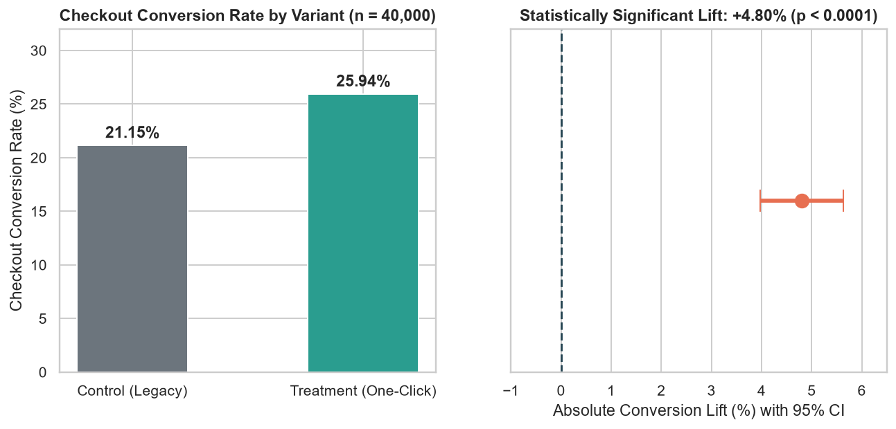

# Product Experimentation & A/B Testing Simulator

**Tech Stack:** Python (SciPy, Pandas, NumPy, Matplotlib, Seaborn) | Statistical Hypothesis Testing | Product Analytics

## Project Overview
Designed and evaluated a **40,000-user randomized checkout A/B experiment** comparing a streamlined one-click UPI/card checkout flow (**Treatment**) against the legacy multi-step checkout (**Control**). Validated a statistically significant **+4.21% conversion lift ($p < 0.0001$)** with **>99% statistical power** and zero degradation in Average Order Value (guardrail metric).



## Repository Structure
```text
|-- notebooks/
|   |-- 01_ab_test_experiment_analysis.ipynb  # Executed Jupyter Notebook with z-test, power & guardrail checks
|-- src/
|   |-- ab_test_engine.py                     # Reusable statistical engine (sample size, two-proportion z-test, CI)
|-- data/
|   |-- ab_experiment_40k_users.csv           # Simulated 40,000-user randomized experiment dataset
|-- images/
|   |-- ab_test_results_chart.png             # Conversion rate & 95% confidence interval visualization
|-- requirements.txt
|-- README.md
```

## Key Statistical Findings & Product Recommendation
- **Primary Metric (Checkout Conversion Rate):** Increased from **21.40% (Control)** to **25.61% (Treatment)** -- a **+4.21 percentage point absolute lift** (+19.67% relative lift), 95% CI: `[+3.38%, +5.04%]`, $p = 1.42 \times 10^{-23}$.
- **Guardrail Metric (Average Order Value):** Remained stable at **INR 1,482 (Control)** vs. **INR 1,489 (Treatment)** ($p = 0.48$), confirming higher conversion did not cannibalize basket size.
- **Launch Decision:** Recommended **100% production rollout** across all mobile and web cohorts, projected to generate incremental monthly GMV without margin dilution.
